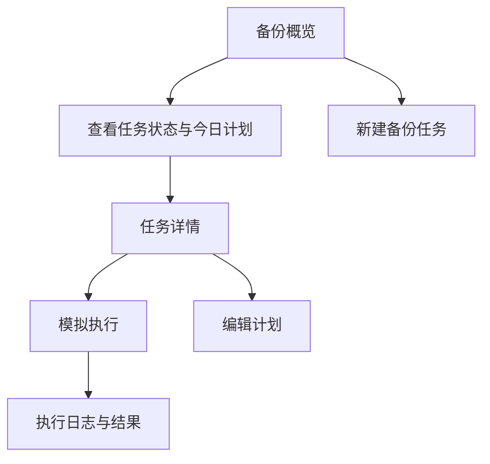
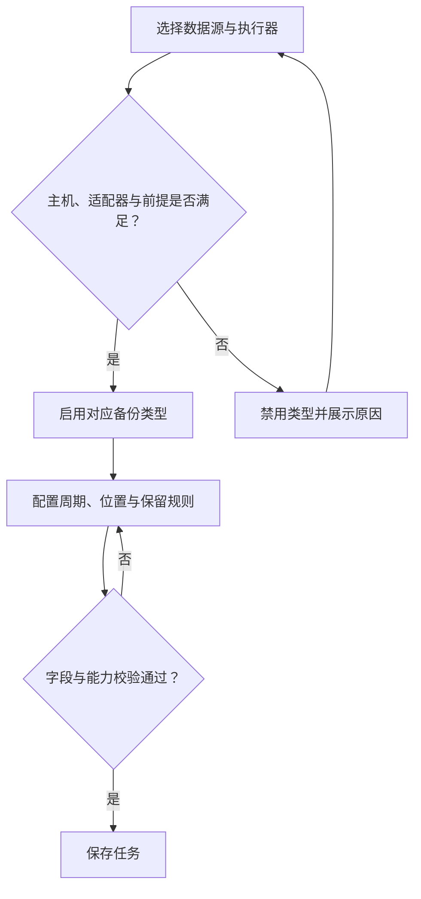
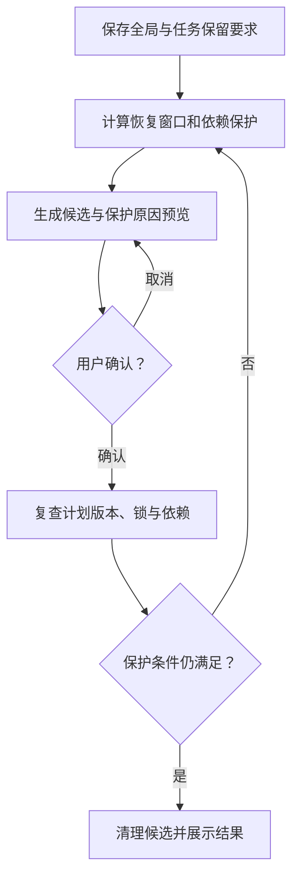
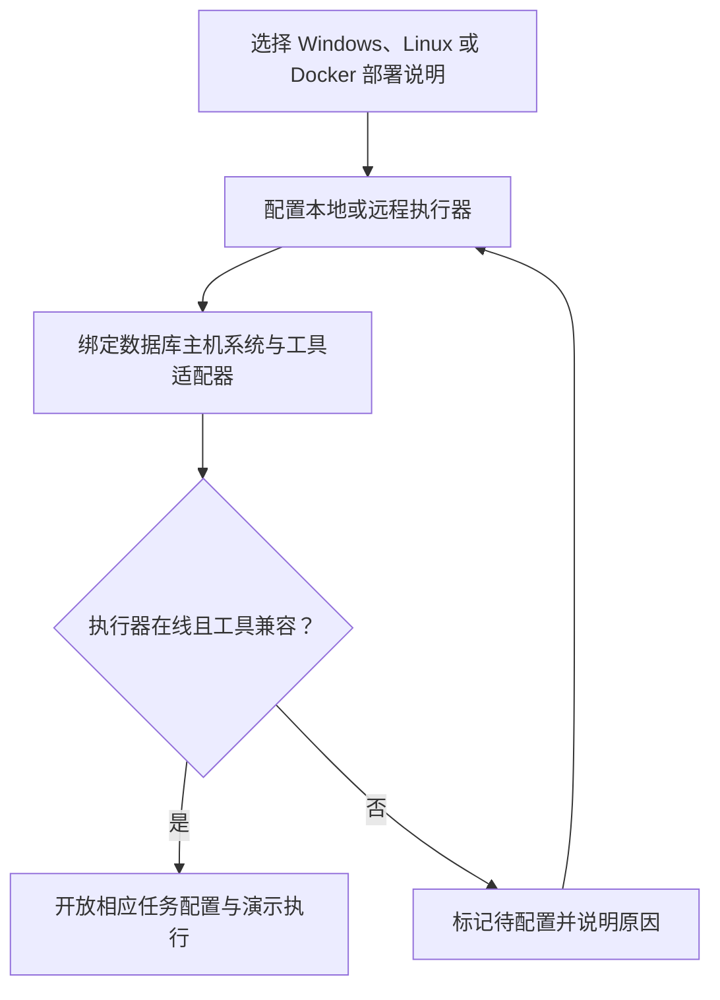

# DBBak 数据库备份管理原型设计说明

页面结构 字段规则 交互状态与评审路径

版本：1.1 · 日期：2026-10-30 · 状态：设计评审稿

配套文件：[产品需求](DBBak_产品需求文档.md) · [开发文档](DBBak_开发文档.md) · [HTML 交互原型](../web/index.html)

使用方式：当前前端由 DBBak Go 服务统一提供，访问 `http://127.0.0.1:8080/`。保留的原型目录包含独立 CSS、JavaScript 和图标，样式仍可回退引用 Google Fonts；不再宣称单文件内联或完全离线。页面已接入真实 API，不使用 localStorage 保存任务配置，也不以模拟操作替代备份或删除。运行与验证见根目录 README 和阶段一验证报告。

## 1 原型范围与页面导航

本说明供产品、设计、开发与测试人员共同评审。原型采用深绿导航与浅色工作区，统一展示数据库备份任务、存储、执行记录及清理规则；新增 Windows、Linux、Docker 部署说明和演示执行器管理。

当前代码已在此基础上实现真实 API 页面：MySQL 数据源、PostgreSQL 维护库、存储、全量任务、运行记录、备份文件和清理预览均来自 SQLite。文中流程图继续用于说明页面关系；具体已实现能力和未运行项以阶段一及阶段二 PostgreSQL 验证报告为准。

[打开 HTML 交互原型](../web/index.html)

| 页面 | 主要内容 | 主要动作 |
| --- | --- | --- |
| 备份概览 | 样例指标 数据趋势 今日计划 | 新建任务 进入任务详情 |
| 备份任务 | 任务列表 搜索 类型与状态筛选 | 创建 编辑 暂停 模拟执行 |
| 数据库 | 主机系统 适配器 执行器 | 新增 编辑 能力联动 |
| 存储位置 | 本地目录 网络共享 S3 | 新增 编辑 路径格式检查 |
| 执行日志 | 结果 运行时间 文件大小 | 筛选 查看详情 导出 |
| 清理策略 | 保留规则 恢复链保护 | 保存策略 预览 确认清理 |
| 部署与执行器 | 部署方案 工具与能力状态 | 切换部署方案 管理执行器 |
| 系统设置 | 时区 验证偏好 接入说明 | 保存偏好 导出配置 |

正式版应复用这些页面关系，并接入真实权限、任务调度、数据库工具和恢复验证。部署包下载、账号权限及真实告警不属于当前原型已实现能力。

## 2 工作台概览

[在 HTML 中查看对应页面](../web/index.html#overview)。流程图用于说明操作关系，界面布局以 HTML 为准。

概览把任务入口放在标题右侧。上方展示纳管数量、任务状态、样例成功率与容量；中间展示趋势和计划；下方提供常用任务的运行与编辑入口。统计数字不能替代单次任务的可恢复性检查。

| 区域 | 交互规则 |
| --- | --- |
| 全局导航 | 保留当前位置；支持页面 hash 深链。窄屏折叠导航，选择页面后收起。 |
| 任务搜索 | 输入任务或数据库名称并回车进入筛选结果；无结果显示空状态。 |
| 运行与编辑 | 运行按钮触发模拟全量备份；编辑打开任务表单。重复运行需被阻止。 |
| 状态表达 | 状态同时使用文字与颜色；正式版成功率与时间均由服务端统计。 |

视觉规范使用 12 px 卡片圆角、翡翠绿主操作色及灰绿辅助文字。正式版应保持正文易读、键盘焦点可见，所有图标按钮提供可访问名称。

## 3 备份任务编辑

[在 HTML 中查看对应页面](../web/index.html#tasks)。流程图用于说明操作关系，界面布局以 HTML 为准。

- 基本信息包含任务名称和数据源。数据源确定主机系统、执行器及适配器，随后更新可选备份类型和禁用原因。
- 全量可配置每天或每周及执行时刻；差异配置每天时刻；日志配置分钟间隔。默认时区为 Asia/Shanghai。
- 存储位置引用已保存的目标，并可设置子目录。SQL Server 路径必须由数据库服务访问。子目录属于任务配置：本地存储常被多个实例共用，落点为「根目录/子目录/数据库名/年/月/文件」，留空表示直接写入根目录。
- 保留天数与最低全量份数均为正整数。关闭自动清理只影响自动执行，手动清理仍必须通过保护规则。
- 保存先检查必填、路径与能力；能力不满足时提示具体原因。暂停影响后续计划，不等同于终止正在执行的任务。

原型只模拟全量执行，不承诺按浏览器中的计划持续运行。正式版应在保存后返回服务端计算的下次执行时间，冲突时说明原因并允许修改。

## 4 数据源与存储表单

数据源表单依次填写显示名称、数据库类型、主机地址与端口、数据库主机系统、执行器以及备份适配器。数据库主机系统独立于管理软件部署环境；Linux 管理端可以管理 Windows 数据库，但不能据此认定 Linux 物理备份工具可访问该数据库的数据文件。

| 组合 | 原型中的可用能力 | 禁用与提示 |
| --- | --- | --- |
| SQL Server 原生 | 全量 差异 日志 | 日志前提未确认时禁用；完整时间点恢复使用 FULL 模式。 |
| MySQL mysqldump | 全量 binlog | 差异禁用；binlog 需要一致性快照坐标或 GTID。 |
| MySQL Enterprise | 待适配验证 | 默认不认定可执行，需核实主机系统 工具版本和许可。 |
| PostgreSQL Linux pgBackRest | 全量 差异 WAL | 需数据库侧工具 stanza 及连续归档，执行器必须兼容。 |
| PostgreSQL Windows 原生工具 | 全量 WAL | 使用 pg_basebackup 路线；差异默认关闭，单独验证。 |
| PostgreSQL pg_dump | 逻辑全量 | 禁止将逻辑导出标记为 WAL 物理恢复基线。 |

### 存储位置输入规则

| 类型 | 输入示例 | 路径含义 |
| --- | --- | --- |
| 本地目录 | /srv/db-backups 或 D:\\Backups | 选定执行器所在主机的绝对路径。 |
| 网络共享 | \\\\nas\\db-backups | 执行器或数据库服务可访问的共享路径。 |
| S3 | s3://bucket/prefix | 生产版还需 endpoint region 和凭据引用。 |

原型的检查按钮只验证格式，不验证真实网络和写入权限；不收集数据库密码或云密钥。正式版应分别显示连接、权限、容量和工具版本检查结果，失败时保留表单输入。

## 5 保留策略与安全清理

[在 HTML 中查看对应页面](../web/index.html#cleanup)。流程图用于说明操作关系，界面布局以 HTML 为准。

页面先保存策略，再生成清理预览。预览区必须同时呈现候选对象、预计释放容量和受保护对象的原因；确认弹窗再次说明清理范围。原型按数据库合并样例恢复链做保守评估，正式版按保护组与真实依赖图计算。

- 全局规则是最低保留要求，与关联任务取更长天数和更多全量份数。
- 保留期内的恢复时间段，必须同时保留起点所需基线、差异依赖和连续日志；禁止仅按文件日期判断。
- 锁定、正在写入、未完成校验、缺少基线及最近有效恢复链均应受保护。
- 确认执行前再次校验预览版本和依赖；部分删除失败时展示剩余对象并允许重试。

点击清理演示文件只删除浏览器内的样例记录，并同步减少样例容量。当前原型不提供真实文件管理或清理服务。

## 6 部署方案与执行器

[在 HTML 中查看对应页面](../web/index.html#deployment)。流程图用于说明操作关系，界面布局以 HTML 为准。

页面通过 Windows、Linux、Docker 标签切换部署说明。Windows 目标为原生服务，Linux 目标为 systemd，Docker 目标为 Linux 容器镜像与 Compose。三个入口展示设计方案，不提供尚不存在的安装包。

- 演示执行器支持新增、编辑与启停，并记录名称、系统、本地或远程模式及工具信息。
- 数据源引用执行器；执行器离线或缺少兼容工具时，任务显示待配置并阻止模拟执行。
- 能力矩阵把数据库主机系统、适配器和验证状态放在一起；所有演示状态均不代表真实兼容测试已通过。
- Windows 上的 PostgreSQL 不直接套用 pgBackRest；管理端运行在 Docker 中也不会自动改变数据库侧工具要求。

[打开部署与执行器页面](../web/index.html#deployment)

## 7 交互状态与评审步骤

| 状态 | 界面要求 | 当前原型 |
| --- | --- | --- |
| 空列表 | 说明无数据原因，给出创建或重置筛选入口。 | 任务筛选空状态 |
| 执行中 | 显示运行状态，禁止重复触发，日志持续更新。 | 模拟状态变化 |
| 执行失败 | 保留输入与诊断信息，允许受控重试。 | 需关注与中断示例 |
| 刷新中断 | 不把未完成任务标记成功。 | 重载后标记需关注 |
| 能力不足 | 禁用依赖功能，展示前提和修复方向。 | 数据库与执行器联动 |
| 清理保护 | 显示保留原因，禁止越过依赖保护。 | 恢复链预览 |
| 保存失败 | 说明失败原因，不显示成功或丢弃输入。 | 存储不可用提示 |

### 推荐评审路径

- 进入部署与执行器页，切换三种部署方式，并新增一个 Windows 演示执行器。
- 添加 Windows PostgreSQL 数据源，选择原生工具，确认差异不可选；切换 pg_dump 后确认 WAL 不可选。
- 创建有效备份任务，配置周期、位置与保留规则，保存后筛选并编辑。
- 触发模拟备份，查看执行中和完成日志；再暂停任务，确认任务状态变化。
- 设置保留规则并预览，核对保护原因后清理样例，确认文件数量和容量显示。

### 交付与验证边界

阶段一已完成 Go 自动化测试、真实 MySQL 备份与隔离恢复，以及 Chrome 登录、概览、任务、数据库和清理页面验证；未捕获 JavaScript 异常。其他引擎、远程 Agent、自动清理、完整恢复链和三平台安装升级仍未实现或未验证，详见阶段一验证报告。

需求追踪对应产品文档 FR-01 至 FR-12。开发时以服务端能力探测、运行记录和清理计划替换样例数据，不得把未验证能力显示为已支持。

- [官方依据 pgBackRest Windows 支持边界](https://github.com/pgbackrest/pgbackrest/issues/2431)
